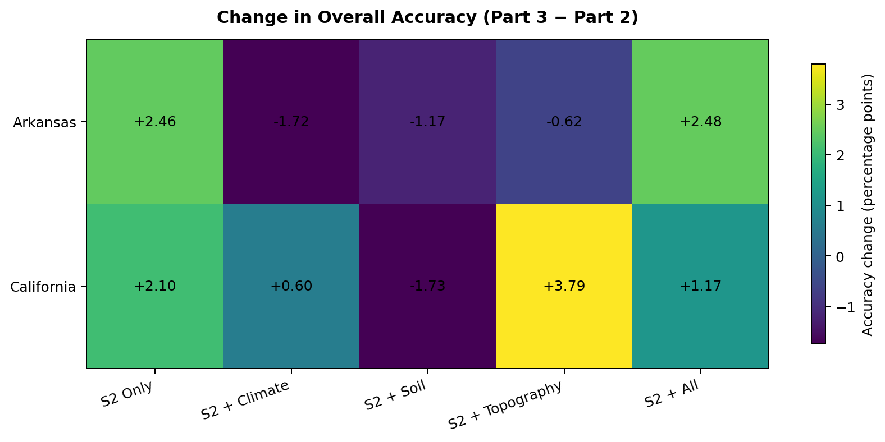

# 🌾 CROPS — Deep Learning for Crop Classification

**Crop classification using multi-source satellite time series and environmental data**

CROPS is an academic research project focused on agricultural crop classification using Deep Learning and Earth observation data. The project explores the use of Sentinel-2 satellite time series, environmental covariates, and a proposed neural network architecture to improve crop classification performance across different geographic regions.

<p align="center">
  
  
  
  
</p>

---

## 📌 Table of Contents

- [Project Overview](#-project-overview)
- [Objectives](#-objectives)
- [Study Areas and Data](#-study-areas-and-data)
- [Methodology](#-methodology)
- [Experimental Results](#-experimental-results)
- [Technologies](#-technologies)
- [Repository Structure](#-repository-structure)
- [Getting Started](#-getting-started)
- [Limitations](#-limitations)
- [Academic Context](#-academic-context)

---

## 🌍 Project Overview

Accurate crop classification is important for agricultural monitoring, land-use mapping, and food security. Satellite imagery provides repeated observations of agricultural areas throughout the growing season, allowing crop types to be distinguished through their temporal spectral patterns.

This project investigates crop classification using **Sentinel-2 time series** and evaluates whether adding environmental information and a different neural network architecture can improve classification performance.

The work is organized into three parts:

1. **MCTNet reproduction:** implementation and evaluation of a baseline model for crop classification using Sentinel-2 time series.
2. **Environmental covariates:** investigation of the contribution of climate, soil, and topographic information.
3. **Model improvement:** evaluation of a proposed MS-SE-BiGRU-Attn architecture.

The experiments focus on two study regions in the United States: **Arkansas and California**.

## 🎯 Objectives

- Reproduce a Deep Learning approach for crop classification from multi-temporal satellite observations.
- Process Sentinel-2 temporal data for agricultural mapping.
- Investigate the contribution of environmental covariates.
- Compare different input configurations and neural network architectures.
- Evaluate classification performance across two geographic regions.
- Explore an alternative architecture combining feature recalibration, bidirectional recurrent layers, and attention.

## 🛰️ Study Areas and Data

### Sentinel-2 time series

The project uses Sentinel-2 Level-2A satellite observations to represent the temporal evolution of agricultural surfaces.

The baseline configuration described in the experiments includes:

- **10 spectral bands**
- **36 temporal slots**
- Ten-day temporal intervals
- Observations spanning the agricultural season

The resulting input representation is a multivariate time series for each sampled pixel.

### Reference labels and masking

The experimental workflow uses crop labels from the **2021 Cropland Data Layer (CDL)**, a confidence-based label selection procedure, and an ESA WorldCover mask to help select relevant pixels.

### Study regions

| Region | Objective |
|---|---|
| Arkansas | Evaluate crop classification performance in one agricultural region |
| California | Evaluate performance and generalization across a different region |

### Environmental covariates

The project also investigates additional information beyond satellite spectral observations:

- **Climate:** environmental and climatic variables.
- **Soil:** soil-related characteristics.
- **Topography:** terrain-related information.
- **Combined covariates:** integration of multiple environmental sources.

The goal is to determine whether these additional data sources provide complementary information for crop classification.

## 🧠 Methodology

### Part 1 — MCTNet reproduction

The first part focuses on reproducing the MCTNet approach for crop classification from Sentinel-2 time series.

The workflow includes:

1. Preparing the temporal satellite data.
2. Selecting labeled pixels and applying the masking procedure.
3. Representing each pixel using its spectral observations over time.
4. Handling missing temporal observations.
5. Training the baseline model.
6. Evaluating performance using accuracy, Cohen's Kappa, and Macro F1-score.

The implementation uses PyTorch. The reproduced model contains approximately **55,059 trainable parameters**, according to the recorded model configuration.

### Part 2 — Environmental covariate integration

The second part investigates how environmental information affects classification performance.

Several configurations are compared:

- Sentinel-2 only
- Sentinel-2 + climate
- Sentinel-2 + soil
- Sentinel-2 + topography
- Sentinel-2 + all available covariates

This ablation study helps identify which combinations of data are most useful in each study region.

### Part 3 — Proposed architecture: MS-SE-BiGRU-Attn

The third part explores a proposed architecture called **MS-SE-BiGRU-Attn**.

Its name reflects the combination of:

- **MS:** multi-source feature integration.
- **SE:** Squeeze-and-Excitation-style feature recalibration.
- **BiGRU:** bidirectional gated recurrent units for temporal sequence modeling.
- **Attention:** emphasis on informative representations.

The objective is to model temporal patterns while leveraging complementary information from different data sources.

The proposed approach is evaluated against the baseline and under different input configurations.

## 📊 Experimental Results

The results below report the metrics recorded in the project experiments. They should be interpreted in the context of the corresponding experimental configuration.

### 1. Baseline MCTNet reproduction

The first experiment reported the following test results:

| Region | Overall Accuracy | Cohen's Kappa | Macro F1-score |
|---|---:|---:|---:|
| Arkansas | 85.69% | 0.7929 | 79.75% |
| California | 81.61% | 0.7605 | 74.04% |

These results provide a baseline for evaluating crop classification from Sentinel-2 temporal observations.

### 2. Baseline versus proposed architecture

The model comparison recorded in Part 3 reports:

| Region | MCTNet Accuracy | MS-SE-BiGRU-Attn Accuracy | Difference |
|---|---:|---:|---:|
| Arkansas | 84.59% | 89.65% | +5.06 percentage points |
| California | 81.83% | 83.13% | +1.30 percentage points |

The proposed architecture obtains higher reported accuracy in both regions in this comparison. The difference is larger in Arkansas than in California.

**Experimental note:** the MCTNet accuracy values in this comparison differ from those reported in the initial reproduction. These values come from different recorded experiment tables and should not be treated as a strictly controlled comparison until the data splits, evaluation protocol, and model checkpoints have been verified.

### Model comparison visualization


### 3. Environmental covariate ablation

The following table summarizes the recorded Overall Accuracy for the five input configurations in Parts 2 and 3.

#### California

| Input configuration | Part 2 | Part 3 |
|---|---:|---:|
| Sentinel-2 only | 79.84% | 81.94% |
| Sentinel-2 + climate | 81.16% | 81.76% |
| Sentinel-2 + soil | 82.74% | 81.01% |
| Sentinel-2 + topography | 79.80% | 83.59% |
| Sentinel-2 + all covariates | 83.67% | 84.84% |

#### Arkansas

| Input configuration | Part 2 | Part 3 |
|---|---:|---:|
| Sentinel-2 only | 74.75% | 77.21% |
| Sentinel-2 + climate | 80.91% | 79.19% |
| Sentinel-2 + soil | 80.75% | 79.58% |
| Sentinel-2 + topography | 79.46% | 78.84% |
| Sentinel-2 + all covariates | 78.84% | 81.32% |

### Covariate ablation visualization


### Accuracy difference visualization



### Interpretation

The recorded results suggest that the contribution of environmental covariates depends on the study region and the experimental configuration.

- In Part 2, **Sentinel-2 + climate** obtains the highest recorded accuracy for Arkansas among the tested configurations.
- In Part 2, **Sentinel-2 + all covariates** obtains the highest recorded accuracy for California.
- In Part 3, **Sentinel-2 + all covariates** achieves the highest recorded accuracy in both regions.
- The relative contribution of climate, soil, and topography is not identical across regions.

These findings motivate further investigation of multi-source data integration. Since the two parts contain different experimental results, comparisons across them should be made only after confirming that their evaluation protocols are compatible.

## 🛠️ Technologies

| Category | Technologies |
|---|---|
| Programming language | Python |
| Deep Learning | PyTorch |
| Data processing | NumPy, Pandas |
| Visualization | Matplotlib |
| Satellite data | Sentinel-2 Level-2A |
| Geospatial and reference data | CDL 2021, ESA WorldCover |
| Development environment | Jupyter Notebook |
| Version control | Git, GitHub |

## 📁 Repository Structure

The repository contains the notebooks and experimental materials used throughout the project. A possible organization for the main files is shown below; adjust the names to match the actual files in the repository.

```text
crops/
├── README.md
├── partie1_enrichi.ipynb
├── partie2_visualisations_1.ipynb
├── partie3_amelioration.ipynb
└── results/
    ├── accuracy_comparison.png
    ├── covariates_ablation.png
    └── delta_accuracy_heatmap.png
```

- `partie1_enrichi.ipynb`: baseline MCTNet reproduction and evaluation.
- `partie2_visualisations_1.ipynb`: environmental covariate experiments and visualizations.
- `partie3_amelioration.ipynb`: proposed architecture and additional experiments.
- `results/`: figures displayed in this README.

If your notebooks have different names or are stored in subdirectories, update this tree accordingly.

## 🚀 Getting Started

### Prerequisites

- Python 3
- Jupyter Notebook or JupyterLab
- PyTorch
- NumPy
- Pandas
- Matplotlib

A CUDA-compatible GPU can accelerate model training, but availability depends on your PyTorch installation and hardware.

### Installation

Clone the repository:

```bash
git clone https://github.com/lynaar/crops.git
cd crops
```

Create and activate a virtual environment:

```bash
python -m venv .venv
```

On Windows:

```powershell
.venv\Scripts\Activate.ps1
```

On Linux or macOS:

```bash
source .venv/bin/activate
```

Install the basic libraries:

```bash
pip install numpy pandas matplotlib jupyter
```

Install a compatible PyTorch version by following the instructions on the official [PyTorch website](https://pytorch.org/get-started/locally/).

Launch Jupyter:

```bash
jupyter notebook
```

Open the relevant notebook to inspect the workflow and experiments.

**Important:** these commands install the basic environment only. Running the experiments also requires the datasets, the correct file paths, and any additional dependencies used by the notebooks. Dataset download and preprocessing commands are not provided here because they depend on the original data access and project setup.

## ⚠️ Limitations and Future Work

The current experiments provide a basis for exploring multi-source crop classification, but several aspects deserve further investigation:

- Verify consistency between the baseline results reported by different experiments.
- Ensure identical train, validation, and test splits when comparing architectures.
- Evaluate performance across additional years and geographic regions.
- Investigate class imbalance and performance on underrepresented crop classes.
- Study the contribution of each environmental covariate through controlled ablation experiments.
- Evaluate robustness to missing satellite observations and variations in temporal coverage.
- Report per-class precision, recall, F1-score, and confusion matrices alongside Overall Accuracy.
- Repeat experiments with multiple random seeds where feasible.

These steps would help establish more reliable conclusions about the generalization capabilities of the proposed approach.

## 🎓 Academic Context

**Institution:** USTHB — Faculty of Computer Science  
**Program:** Master in Intelligent Computer Systems (SII)  
**Academic year:** 2025–2026  

**Project:** Deep Learning for Crop Classification Using Multi-Source Satellite Data

The project covers baseline reproduction, environmental covariate integration, and the investigation of an alternative neural network architecture for agricultural crop classification.

---

<p align="center">
  <i>Exploring Deep Learning and multi-source Earth observation data for agricultural monitoring.</i>
</p>
