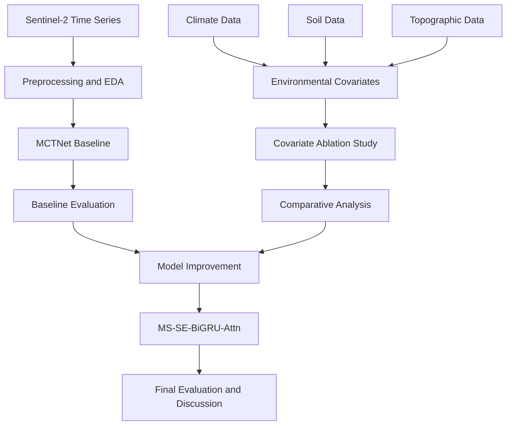
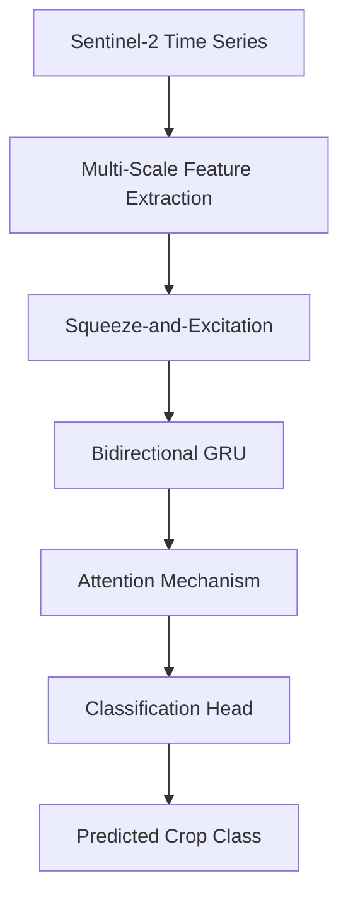
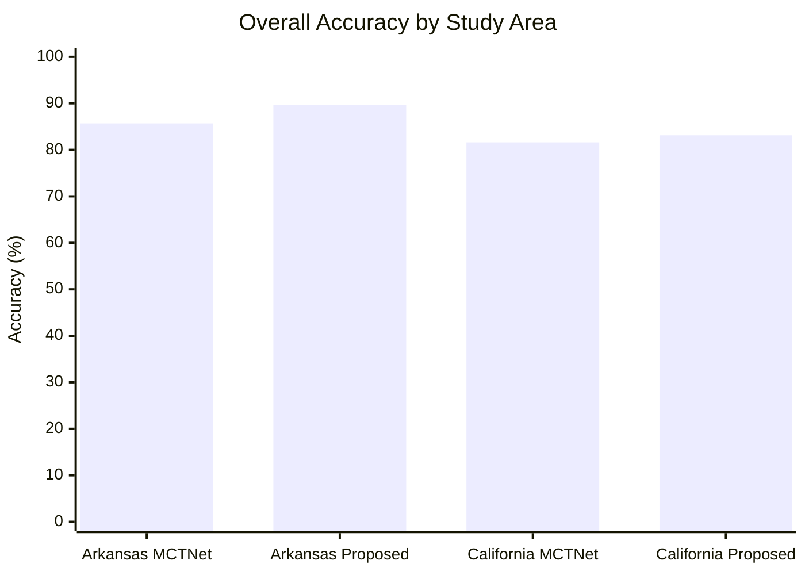
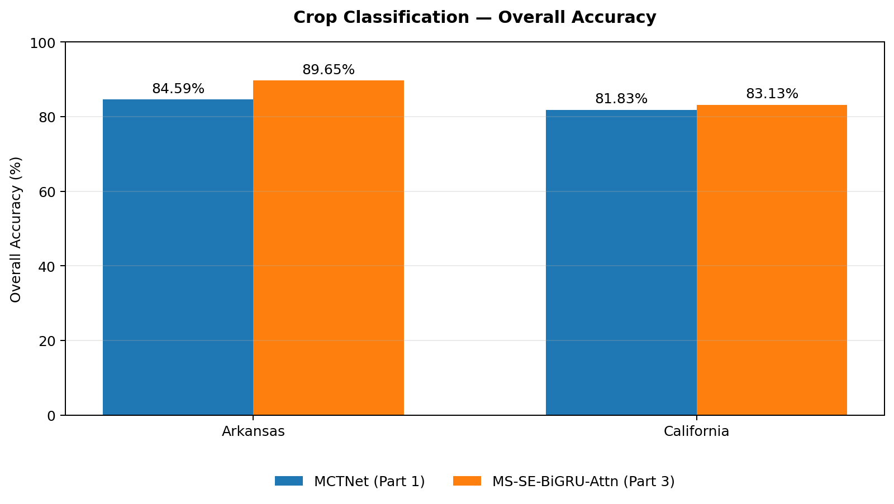
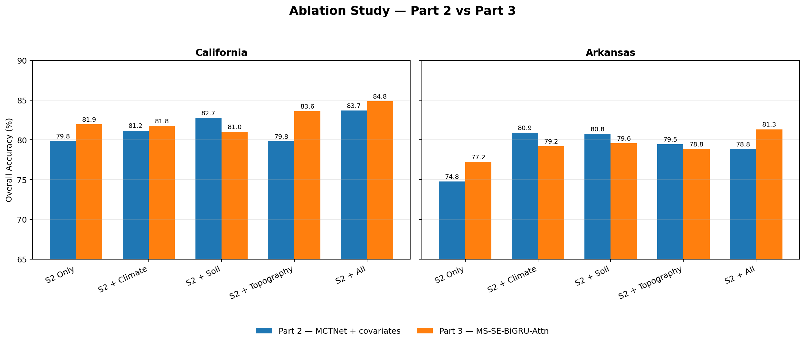

# 🌾 CROPS — Deep Learning for Agricultural Crop Classification

<p align="center">
  <strong>Multi-Temporal Satellite Imagery · Deep Learning · Remote Sensing</strong>
</p>

<p align="center">
  
  
  
  
  
</p>

<p align="center">
  <em>Reproducing MCTNet, integrating environmental covariates, and exploring an improved temporal deep learning architecture for agricultural crop mapping.</em>
</p>

---

## 📌 Table of Contents

- [Overview](#-overview)
- [Project Objectives](#-project-objectives)
- [Study Areas and Dataset](#-study-areas-and-dataset)
- [Project Methodology](#-project-methodology)
- [Part 1 — MCTNet Reproduction](#-part-1--mctnet-reproduction)
- [Part 2 — Environmental Covariates](#-part-2--environmental-covariates)
- [Part 3 — Proposed Architecture](#-part-3--proposed-architecture)
- [Experimental Results](#-experimental-results)
- [Visualizations](#-visualizations)
- [Repository Structure](#-repository-structure)
- [Installation and Usage](#-installation-and-usage)
- [Technologies](#-technologies)
- [Limitations and Future Work](#-limitations-and-future-work)
- [Academic Context](#-academic-context)
- [References](#-references)

## 🔎 Overview

Accurate agricultural crop classification is essential for crop monitoring, agricultural planning, food security assessment, and environmental management.

Satellite imagery, particularly multi-temporal Sentinel-2 observations, provides valuable information about vegetation throughout the growing season. Different crop types exhibit distinct spectral and temporal patterns that can be learned using deep learning models.

**CROPS** is an academic project investigating pixel-based crop classification using satellite time series and environmental information.

The project is divided into three complementary stages:

1. **Baseline reproduction:** Reimplementing and evaluating MCTNet using Sentinel-2 time-series data.
2. **Environmental data integration:** Investigating the contribution of climate, soil, and topographic covariates through ablation experiments.
3. **Model improvement:** Developing and evaluating MS-SE-BiGRU-Attn to improve temporal representation learning.

Experiments are conducted on agricultural data from **Arkansas and California, USA**.

## 🎯 Project Objectives

- Reproduce a published deep learning approach for satellite-based crop mapping.
- Understand the preprocessing and temporal representation of Sentinel-2 observations.
- Investigate the effects of missing observations and temporal data coverage.
- Evaluate the contribution of environmental covariates to crop classification.
- Design an improved architecture for modeling temporal dependencies.
- Compare model performance using accuracy, Cohen's Kappa, and F1-score.
- Analyze experimental results and identify opportunities for future improvements.

## 🗺️ Study Areas and Dataset

### Geographic Coverage

The experiments focus on two agricultural regions in the United States.

| Study area | Region | Samples in the provided CSV |
|---|---|---:|
| Arkansas | United States | 10,000 |
| California | United States | 10,000 |

### Sentinel-2 Time Series

The baseline representation consists of:

| Property | Description |
|---|---|
| Satellite | Sentinel-2 |
| Data type | Multi-temporal spectral observations |
| Temporal dimension | 36 time slots |
| Spectral dimension | 10 bands |
| Features per sample | 360 |
| Classification unit | Agricultural pixel |
| Reference labels | Cropland Data Layer (CDL) |

The 36 temporal observations capture vegetation development across the growing season. The spectral information and temporal evolution jointly provide discriminative features for identifying crop types.

### Environmental Covariates

The second part investigates additional environmental information:

- **Climate:** Environmental and climatic conditions affecting crop development.
- **Soil:** Soil properties that may help distinguish agricultural environments.
- **Topography:** Terrain-related characteristics that provide additional spatial context.

These data sources are evaluated individually and jointly with Sentinel-2 observations.

> **Dataset note:** The CSV files contain 10,000 samples per study area and 360 Sentinel-2 features per sample. Their exact label encoding, feature ordering, train/test protocol, and any associated masks should be checked in the notebooks before reusing the data.

## 🧠 Project Methodology

The overall workflow is organized into three stages.



## 🧪 Part 1 — MCTNet Reproduction

### Objective

Reproduce the methodology of the paper *A Lightweight CNN-Transformer Network for Pixel-Based Crop Mapping Using Time-Series Sentinel-2 Imagery*.

The objective is to establish a baseline and assess how well the reproduced architecture classifies agricultural pixels in both study areas.

### Main Steps

1. **Data exploration:** Examine sample distributions, spectral features, missing observations, and temporal coverage.
2. **Preprocessing:** Prepare the temporal sequences and align spectral observations with crop labels.
3. **Model implementation:** Implement the MCTNet architecture in PyTorch.
4. **Training:** Train and validate the model using the prepared datasets.
5. **Evaluation:** Calculate classification metrics and analyze the results.

### Baseline Architecture

MCTNet combines convolutional and Transformer-based components to extract useful features from satellite time series.

The reproduced implementation includes temporal processing, feature fusion blocks, and a classification head.

The final model checkpoints are available in the `models/` directory.

### Baseline Results

| Study area | Overall Accuracy | Cohen's Kappa | Macro F1-score |
|---|---:|---:|---:|
| Arkansas | 85.69% | 0.7929 | 79.75% |
| California | 81.61% | 0.7605 | 74.04% |

These results provide the reference point for subsequent experiments.

## 🌍 Part 2 — Environmental Covariates

### Objective

Investigate whether environmental information improves crop classification compared with using Sentinel-2 observations alone.

### Experimental Configurations

Five configurations are evaluated:

| Configuration | Input features |
|---|---|
| S2 Only | Sentinel-2 spectral time series |
| S2 + Climate | Sentinel-2 and climate variables |
| S2 + Soil | Sentinel-2 and soil properties |
| S2 + Topography | Sentinel-2 and topographic variables |
| S2 + All | Sentinel-2 and all environmental covariates |

### Ablation Study

The ablation study compares the classification performance obtained with each configuration.

This makes it possible to investigate:

- Whether environmental variables improve performance over the baseline.
- Which covariate group provides the greatest benefit.
- Whether combining different sources produces complementary information.
- Whether the contribution of environmental data varies between Arkansas and California.

### Reported Accuracy Comparisons

The following values are reported for selected configurations in the project experiments.

| Study area | S2 Only | Selected enhanced configuration |
|---|---:|---:|
| Arkansas | 74.75% | 80.91% — S2 + Climate |
| California | 79.84% | 83.67% — S2 + All |

These values correspond to the covariate experiment results and should not be mixed directly with the MCTNet baseline scores without verifying the evaluation protocols.

A complete comparison should include all five configurations for both regions.

## 🚀 Part 3 — Proposed Architecture: MS-SE-BiGRU-Attn

### Motivation

Although the baseline architecture provides a useful starting point, crop classification remains challenging because of temporal variability, missing observations, similarities between crop types, and differences between study areas.

The proposed architecture explores complementary mechanisms for feature extraction and temporal modeling.

### Architecture Components

**MS — Multi-Scale Feature Extraction**

Extracts information at different temporal or feature scales to capture complementary patterns in vegetation development.

**SE — Squeeze-and-Excitation**

Recalibrates feature channels by learning their relative importance, helping the network emphasize informative representations.

**BiGRU — Bidirectional Gated Recurrent Unit**

Models temporal dependencies in both forward and backward directions, allowing the network to use information from earlier and later observations.

**Attention Mechanism**

Assigns different importance to learned representations to emphasize informative temporal features.

### Conceptual Workflow



This diagram illustrates the conceptual design. The precise order of operations, dimensions, fusion strategy, and implementation details should follow the actual model code.

### Reported Results

| Study area | MCTNet Baseline | Proposed Model |
|---|---:|---:|
| Arkansas | 85.69% | 89.65% |
| California | 81.61% | 83.13% |

The proposed model reports higher accuracy in both regions. A rigorous comparison should additionally verify identical test samples, preprocessing, and evaluation settings.

## 📊 Experimental Results

### Overall Accuracy Comparison

The following chart uses the reported baseline and proposed-model accuracies.



### Baseline Evaluation Metrics

| Metric | Arkansas | California |
|---|---:|---:|
| Overall Accuracy | 85.69% | 81.61% |
| Cohen's Kappa | 0.7929 | 0.7605 |
| Macro F1-score | 79.75% | 74.04% |

**Overall Accuracy (OA):** Measures the proportion of correctly classified samples.

**Cohen's Kappa:** Measures agreement between predictions and reference labels while accounting for chance agreement.

**Macro F1-score:** Calculates the F1-score for each class and averages them equally, making it useful when class distributions are imbalanced.

### Interpretation

The baseline achieves higher overall accuracy in Arkansas than in California. The difference may reflect variations in data coverage, class distributions, crop characteristics, or other experimental factors; further analysis is needed to identify the causes.

The proposed architecture reports an increase of **3.96 percentage points** in Arkansas and **1.52 percentage points** in California compared with the reported MCTNet baseline.

These differences are descriptive comparisons of the reported results, not proof of statistical significance.

## 🖼️ Visualizations

The repository can include generated figures from the notebooks to make the experiments easier to understand and reproduce.

Create a `results/` directory and add the corresponding image files.

### 1. Model Performance



*Comparison of MCTNet and MS-SE-BiGRU-Attn across Arkansas and California.*

### 2. Environmental Covariate Ablation



*Accuracy comparison across S2 Only, S2 + Climate, S2 + Soil, S2 + Topography, and S2 + All configurations.*

### 3. Confusion Matrix — Arkansas


*Confusion matrix showing the distribution of correct and incorrect predictions across crop classes.*

### 4. Confusion Matrix — California


*Confusion matrix showing class-level performance in California.*

### 5. Training Curves


*Training and validation loss and accuracy, when available, to help analyze convergence and overfitting.*

> **Important:** These Markdown references do not generate the images automatically. The PNG files must exist at the specified paths in the GitHub repository. Remove or rename any reference that does not correspond to a real figure.

## 📁 Repository Structure

```text
crops/
├── csv_partie2/
│   └── Environmental covariate datasets
├── models/
│   ├── mctnet_arkansas_final.pth
│   ├── mctnet_california_final.pth
│   ├── part2_AR_S2_only.pth
│   ├── part2_AR_S2_climate.pth
│   ├── part2_AR_S2_soil.pth
│   ├── part2_AR_S2_topo.pth
│   ├── part2_AR_S2_all.pth
│   ├── part2_CA_S2_only.pth
│   ├── part2_CA_S2_climate.pth
│   ├── part2_CA_S2_soil.pth
│   ├── part2_CA_S2_topo.pth
│   └── part2_CA_S2_all.pth
├── results/
│   ├── accuracy_comparison.png
│   ├── covariates_ablation.png
│   ├── confusion_matrix_arkansas.png
│   ├── confusion_matrix_california.png
│   └── training_curves.png
├── ARKANSAS_10000x360.csv
├── CALIFORNIA_10000x360.csv
├── partie1_enrichi.ipynb
├── partie2_visualisations_1.ipynb
├── partie3_amelioration.ipynb
├── sentinel.md
└── README.md
```

The `results/` directory and its example image filenames should be added as the corresponding figures become available.

## ⚙️ Installation and Usage

### Prerequisites

- Python 3.10 or a compatible version supported by the selected dependencies.
- Git.
- Jupyter Notebook or JupyterLab.
- PyTorch installed for the available CPU or CUDA environment.

### 1. Clone the Repository

```bash
git clone https://github.com/lynaar/crops.git
cd crops
```

### 2. Create a Virtual Environment

```bash
python -m venv .venv
```

Activate it on Windows:

```powershell
.\.venv\Scripts\Activate.ps1
```

On Linux or macOS:

```bash
source .venv/bin/activate
```

### 3. Install Dependencies

```bash
pip install numpy pandas matplotlib seaborn scikit-learn jupyter
```

Install the appropriate PyTorch build separately by following the official instructions: https://pytorch.org/get-started/locally/

Additional packages may be necessary depending on the notebook imports.

### 4. Launch Jupyter

```bash
jupyter notebook
```

Run the notebooks according to their dependencies:

1. `partie1_enrichi.ipynb` — baseline model and data preparation.
2. `partie2_visualisations_1.ipynb` — environmental covariates and ablation analysis.
3. `partie3_amelioration.ipynb` — proposed architecture and evaluation.

**Reproducibility note:** Check all data paths, random seeds, package versions, and train/test split definitions before rerunning experiments. Existing `.pth` checkpoints may require the original model definitions and compatible preprocessing.

## 🧰 Technologies

| Category | Tools |
|---|---|
| Programming | Python |
| Deep Learning | PyTorch |
| Data Processing | NumPy, Pandas |
| Visualization | Matplotlib, Seaborn |
| Evaluation | Scikit-learn |
| Development | Jupyter Notebook, Google Colab |
| Version Control | Git, GitHub |
| Remote Sensing | Sentinel-2 time series |

## ⚠️ Limitations and Future Work

Potential directions for further research include:

- Improving temporal coverage and handling missing satellite observations.
- Investigating class imbalance and minority-class recognition.
- Performing additional ablation studies on individual architecture components.
- Evaluating generalization to other regions and growing seasons.
- Comparing models under identical evaluation protocols.
- Reporting per-class precision, recall, F1-score, and confusion matrices.
- Exploring spatially independent validation and uncertainty estimation.
- Improving experiment reproducibility through saved configurations and random seeds.

## 🎓 Academic Context

**University:** University of Science and Technology Houari Boumediene (USTHB)  
**Faculty:** Faculty of Computer Science  
**Program:** Master 1 — Intelligent Computer Systems (M1 SII)  
**Academic Year:** 2025–2026

**Project title:** *Deep Learning for Crop Classification Using Multi-Source Satellite Data*

The project was conducted as part of an academic study of deep learning, temporal modeling, remote sensing, and multi-source data integration.

## 📚 References

1. Wang et al. (2024). *A Lightweight CNN-Transformer Network for Pixel-Based Crop Mapping Using Time-Series Sentinel-2 Imagery.* Add the verified DOI or publication URL here.
2. Sentinel-2 mission documentation: https://dataspace.copernicus.eu/
3. PyTorch documentation: https://pytorch.org/docs/stable/

## 👩‍💻 Author

**Lyna Arezki**  
AI and Deep Learning student

GitHub: https://github.com/lynaar

---

<p align="center">
  <em>Exploring the potential of deep learning and multi-source satellite data for agricultural monitoring.</em>
</p>
